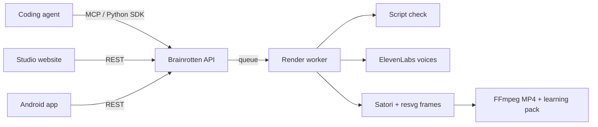

<p align="center">
  <a href="https://www.npmjs.com/package/brainrotten-mcp"></a>
  <a href="https://gitlab.com/wdipak/brainrotten/-/pipelines"></a>
  <a href="LICENSE"></a>
  <a href="https://d3sk6lwsh4ufyv.cloudfront.net"></a>
</p>

# Brainrotten

**AI coding agents change your code faster than you can read it.** Brainrotten turns what your agent just did into a one-minute video you would actually watch: a hand-drawn diagram, two cartoon characters arguing it out, a code review, a ranking, or the parts of your system texting each other. The video stops to ask you what happens next, and ends with a short quiz, so you understand the change instead of just accepting it.

It works in **English, Hinglish and Benglish**, and the first five videos on the website are free.

**[Try it on the website](https://d3sk6lwsh4ufyv.cloudfront.net)** · **[Watch the examples](https://d3sk6lwsh4ufyv.cloudfront.net/examples)** · **[Connect your coding agent](#connect-your-coding-agent)**

---

## How it works

1. **You work with your coding agent as usual** (Claude Code, Codex, Cursor, Kiro, VS Code and others).
2. **Ask it to explain what it did.** It already knows the change and the reasons, so it writes the script itself and picks the best format.
3. **Brainrotten draws it, voices it and renders the video** in the background while your agent keeps working.
4. **You watch it, answer the questions** and keep the notes, transcript and flashcards.

## Five ways to explain a change

Twelve example sessions, beginner to advanced, across Python, JavaScript, Go, Rust, Flutter, Kubernetes and more, in English and Hinglish. All of them are on the [examples page](https://d3sk6lwsh4ufyv.cloudfront.net/examples).

| Format | Best for | Example |
|---|---|---|
| **Sketch board** | Systems, request paths, bugs across components. An Excalidraw-style diagram builds up, the problem in red, the fix in green. | [Blog itna slow kyun hai?](https://d3sk6lwsh4ufyv.cloudfront.net/examples/django-n-plus-one/video.mp4), [Why memory kept climbing](https://d3sk6lwsh4ufyv.cloudfront.net/examples/go-goroutine-leak/video.mp4) |
| **Character skit** | A concept or a misconception. One character asks, the other explains, with real follow-up questions. | [I copied the list. Why did both change?](https://d3sk6lwsh4ufyv.cloudfront.net/examples/python-list-copy/video.mp4), [Why won’t Rust let me push here?](https://d3sk6lwsh4ufyv.cloudfront.net/examples/rust-borrow-checker/video.mp4) |
| **PR review** | A real diff, line by line, as GitHub-style review comments. | [Stop the useEffect request loop](https://d3sk6lwsh4ufyv.cloudfront.net/examples/react-useeffect-loop/video.mp4), [Rate limiter ka race fix](https://d3sk6lwsh4ufyv.cloudfront.net/examples/redis-rate-limiter/video.mp4) |
| **Tier list** | Several options weighed against one rule, ranked S to F. | [Ways to center a card, ranked](https://d3sk6lwsh4ufyv.cloudfront.net/examples/css-center-card/video.mp4), [OOMKilled ke fixes, ranked](https://d3sk6lwsh4ufyv.cloudfront.net/examples/k8s-oomkilled/video.mp4) |
| **Group chat** | Parts of a system "talking" in a WhatsApp-style chat. | [Who blocked my request?](https://d3sk6lwsh4ufyv.cloudfront.net/examples/flask-cors-preflight/video.mp4), [Detached HEAD: kaam gaya kya?](https://d3sk6lwsh4ufyv.cloudfront.net/examples/git-detached-head/video.mp4) |

Videos can pause for **Pause & Predict**: the screen asks what happens next, gives you a few seconds to think, then shows the answer.

---

## Get started

### On the website

Open **[the website](https://d3sk6lwsh4ufyv.cloudfront.net/studio)**, sign in with Google, type a topic or paste an error, pick a format and press Generate. Five videos per account are free.

### Connect your coding agent

Paste this into your terminal (needs [Node.js](https://nodejs.org) 20 or newer):

```bash
npx -y brainrotten-mcp@latest setup
```

It opens Google sign-in in your browser, then adds Brainrotten to every coding agent on your computer: **Claude Code, Codex, Cursor, VS Code, Claude Desktop, Windsurf, Kiro, Gemini CLI and OpenCode**. Your other settings are kept, with a backup of every file it changes. Restart your agent, then ask:

> Explain what we just did as a Brainrotten video.

Prefer not to touch the terminal? Tell your agent: *"Install Brainrotten MCP from https://d3sk6lwsh4ufyv.cloudfront.net/install.md"*. It can do the whole setup, including signing you in.

<details>
<summary>More installer commands</summary>

| Command | What it does |
|---|---|
| `npx -y brainrotten-mcp@latest setup --client cursor,codex` | Only set up the agents you name |
| `npx -y brainrotten-mcp@latest status` | Shows your account, free videos left and the agents found |
| `npx -y brainrotten-mcp@latest uninstall` | Removes Brainrotten from your agents' settings |

On a machine without a browser, add `--no-login`; your agent can then call the `sign_in` tool, which gives you a link to open anywhere.
</details>

---

## For developers

### What's inside



```
apps/
  companion/     Local server (Express + SQLite on 127.0.0.1:3001), the stdio MCP server and the brainrotten-mcp installer
  web/           Website and Studio (React + Vite)
  cloud/         Hosted backend: Lambda API and render worker (container image)
packages/
  contracts/     Zod schemas every client shares: requests, formats, jobs, learning packs, sessions
  core/          Repository evidence and lesson helpers
  media/         Script checks, voices, frame rendering (Satori + resvg, rough.js) and FFmpeg composition
sdk/python/      The MCP tools as Python functions
infra/
  sam/           API stack: API Gateway, Lambda, SQS, DynamoDB, S3, Cognito
  site/          Website stack: private S3 bucket behind CloudFront
  ci/            Keyless GitLab CI deploy role (OIDC) and the private media bucket
assets/          Where third-party media goes locally: not in git (see assets/README.md)
scripts/         Build, release and deploy scripts (scripts/ci for the pipeline)
tools/           Optional local voice model
examples/        Test fixtures
```

### Use it from code

- **REST API:** `https://fqfewiusg8.execute-api.ap-south-1.amazonaws.com/api/v1` with a Cognito access token. OpenAPI spec at [`/openapi.json`](https://fqfewiusg8.execute-api.ap-south-1.amazonaws.com/api/v1/openapi.json); every format's rules and a complete example at `GET /formats/guide?format=sketch`.
- **Python SDK:** `pip install ./sdk/python`, then `Brainrotten(account=True).make_video(request)` validates, generates, waits and returns a small summary. See [sdk/python/README.md](sdk/python/README.md).
- **Mobile:** [ANDROID-INTEGRATION.md](ANDROID-INTEGRATION.md) covers sign-in and every endpoint; [BRAINROTGRAM.md](BRAINROTGRAM.md) is the full spec for the BrainRotGram Android app.

### Run it locally

You need Node.js 26+, pnpm 9+ and FFmpeg.

The repository holds code only. Character cutouts, voices, gameplay clips and example videos are third-party media, kept in a private bucket; maintainers fetch them with `pnpm media:pull` (needs AWS access). Without them everything builds and the tests pass; videos need your own characters and background clips in `assets/` (see [assets/README.md](assets/README.md)).

```bash
pnpm install
cp .env.example .env      # add ELEVENLABS_API_KEY and a script provider key (Gemini or Paper)
pnpm build
pnpm dev                  # Studio at http://127.0.0.1:3001/studio
```

| Command | What it does |
|---|---|
| `pnpm check` | Build, type-check, lint and every test (TypeScript and Python) |
| `pnpm verify:e2e` | Renders a real MP4 in every format through the MCP and HTTP paths, with fake providers (no API credits) |
| `pnpm mcp` | The MCP server against your local Studio |

Tests never call paid services or use real keys.

### Deploys and releases

Deploy from your own computer with your AWS login: `pnpm deploy:site` (website) and `pnpm deploy:backend` (API and worker; needs Docker).

The same steps can also run in GitLab CI: every push and merge request runs the checks (`.gitlab-ci.yml`). On `main`, website changes go live automatically. Backend changes build the Lambda image straight away and go live when you press play on the **deploy-backend** job (about 20 seconds for code-only changes). GitLab signs in to AWS with OIDC, so no AWS keys are stored anywhere. One-time setup: `scripts/ci/bootstrap.sh`.

To release the installer, bump the version in `apps/companion/package.json`, push to `main`, then push the tag `mcp-v<version>`. The pipeline publishes `brainrotten-mcp` to npm through Trusted Publishing with provenance and creates a GitLab release.

---

## Credits and license

Brainrotten is an **unofficial, non-commercial fan project**. The cartoon characters (from *Oggy and the Cockroaches*, *Motu Patlu* and *Bandbudh Aur Budbak*) and the gameplay footage belong to their owners, and the character voices are AI clones: the original actors did not say these lines. Full credits, including fonts, icons and emoji, are in [NOTICE.md](NOTICE.md).

The code is released under the [MIT License](LICENSE). That license does not cover the third-party characters, voices, footage or fonts.

Questions and ideas: [issues](https://gitlab.com/wdipak/brainrotten/-/issues).
